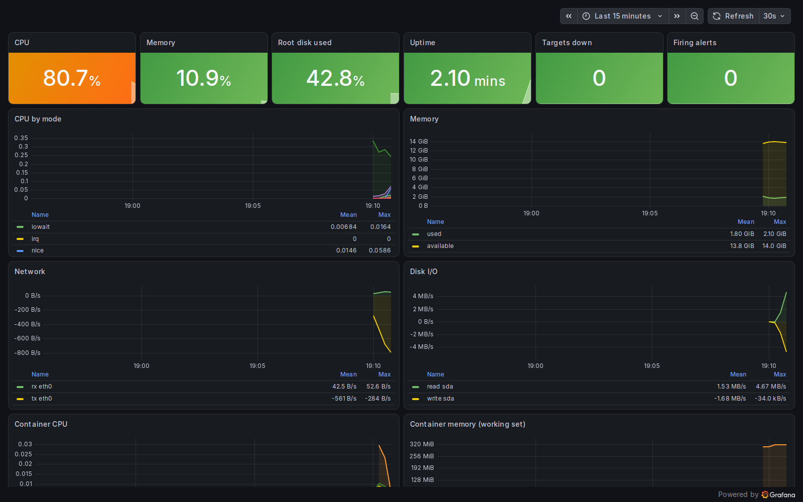
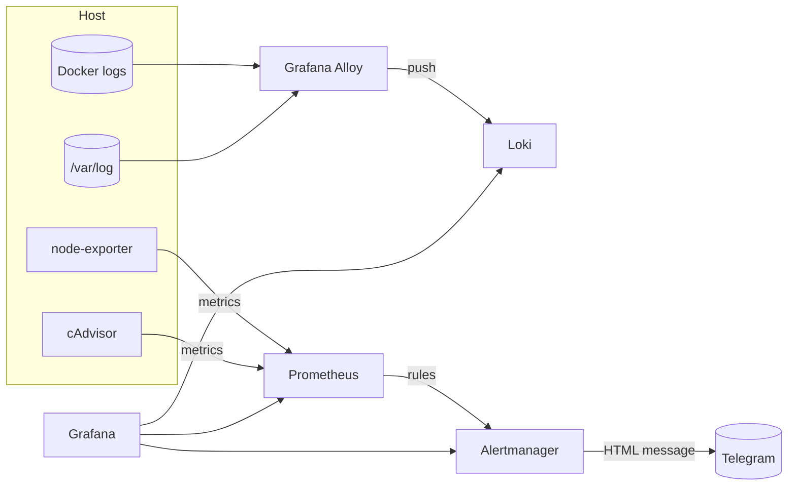

# observability-stack

[](https://github.com/HOFFMAN-ALTERNATIVE/observability-stack/actions/workflows/ci.yml)


Metrics, logs and alerting for a single server or a small fleet, started with one `docker compose up` and verified end to end in CI. Every push boots the full stack and checks that every scrape target is up, rules evaluate, Grafana datasources are healthy, container logs arrive in Loki, and a test alert reaches Alertmanager.

Prometheus · Alertmanager (Telegram) · Grafana (provisioned) · Loki · Grafana Alloy · node-exporter · cAdvisor



*The provisioned "Host & Containers" dashboard, captured by CI on a freshly booted stack.*

The trade-off is scope: one Prometheus and one Loki on local volumes, no HA, no long-term object storage. That is the right size for one to a handful of hosts, and the wrong one for a large fleet.

## Features

- **Metrics:** host (node-exporter) and per-container (cAdvisor) metrics, self-monitoring of every component
- **Logs:** Docker container logs + host logs (syslog, auth, nginx) shipped by **Grafana Alloy**, labelled by container / compose service / level
- **Dashboards:** "Host & Containers" dashboard provisioned from JSON: CPU, memory, disk, network, I/O, container CPU/RAM, live error logs
- **Alerting:** 9 rules (CPU, memory, disk-fill prediction with `predict_linear`, OOM kills, target down, restart loops, container memory limits, Watchdog heartbeat), routed to **Telegram** with an HTML template; critical inhibits warning; Watchdog optionally pings an external dead-man's switch
- **Secure defaults:** ports bound to `127.0.0.1`, Grafana sign-up/anonymous disabled, required admin password, Telegram token never stored in config files, log rotation on every container, retention limits
- **Tested:** `promtool test rules` unit tests for 3 of the 9 alerts (HostHighMemory, HostDiskAlmostFull, TargetDown), `amtool check-config`, `alloy fmt`, `docker compose config`, and a full-stack smoke test in CI

> **Note:** Promtail reached end-of-life; Grafana Alloy is its official successor and is used here.

## Quick start

```bash
git clone https://github.com/HOFFMAN-ALTERNATIVE/observability-stack.git && cd observability-stack
cp .env.example .env          # set GRAFANA_ADMIN_PASSWORD, TELEGRAM_BOT_TOKEN, TELEGRAM_CHAT_ID
docker compose up -d
./scripts/smoke-test.sh       # verifies the whole pipeline (needs curl + jq)
```

| UI | URL |
|---|---|
| Grafana | http://127.0.0.1:3000 → *Observability / Host & Containers* |
| Prometheus | http://127.0.0.1:9090 |
| Alertmanager | http://127.0.0.1:9093 |

For remote access, keep `BIND_ADDR=127.0.0.1` and put a TLS reverse proxy (Caddy/nginx) or an SSH tunnel in front:
`ssh -L 3000:127.0.0.1:3000 user@server`.

## Architecture



## Telegram alerts

1. Create a bot with [@BotFather](https://t.me/BotFather), copy the token.
2. Send any message to the bot (or add it to a group), then get the chat id: `curl https://api.telegram.org/bot<TOKEN>/getUpdates`.
3. Set `TELEGRAM_BOT_TOKEN` and `TELEGRAM_CHAT_ID` in `.env`, `docker compose up -d alertmanager`.

The token is written at container start to a private file read via `bot_token_file`; it never appears in the rendered config or the Alertmanager UI.
Message format lives in `alertmanager/templates/telegram.tmpl`:

```
🔥 FIRING · HostDiskWillFillIn24h (1)
CRITICAL Disk / on host will fill within 24h
Only 1.2GiB predicted free in 24h.
```

## Dead-man's switch

Alerts cannot tell you that the alerting itself is down. The always-firing `Watchdog`
alert covers that: set `DEADMANS_SWITCH_URL` in `.env` to a ping URL from
[healthchecks.io](https://healthchecks.io) or any similar service, and Alertmanager
posts to it every 5 minutes. Configure the check with a 5 minute period and a grace
time of 5 to 10 minutes. If Prometheus, Alertmanager or the whole host dies, the pings
stop and that service alerts you through its own channel.

The URL is written to a private file at start and read via `url_file`, like the
Telegram token. Leave it empty and the Watchdog is dropped. CI runs a drill against a
stand-in receiver to check the pings arrive.

## Adding your services

```yaml
# prometheus/prometheus.yml
  - job_name: api
    static_configs:
      - targets: ["api:8000"]
```

Attach the service to the `observability_obs` network (or use `host.docker.internal`) and reload: `curl -X POST localhost:9090/-/reload`.
Logs of any container on the host are collected automatically.

## Layout

```
compose.yml
prometheus/   prometheus.yml, rules/ (host.yml, targets.yml)
alertmanager/ alertmanager.yml, templates/telegram.tmpl, entrypoint.sh
grafana/      provisioning/ (datasources, dashboards), dashboards/*.json
loki/         loki.yml (TSDB schema v13, 7-day retention, compactor)
alloy/        config.alloy
tests/        promtool rule unit tests, stand-in dead-man's switch for CI
scripts/      smoke-test.sh, screenshot.mjs
```

## Development

```bash
promtool check config prometheus/prometheus.yml
promtool test rules tests/host_test.yml
amtool check-config alertmanager/alertmanager.yml
```

## Design decisions

- [ADR 0001](docs/adr/0001-alloy-for-log-shipping.md): Grafana Alloy ships logs, because
  Promtail is end-of-life and Alloy is its supported successor.
- [ADR 0002](docs/adr/0002-telegram-token-via-file.md): the Telegram token is written at
  start to a private file read through `bot_token_file`, so it never lands in a tracked file.
- [ADR 0003](docs/adr/0003-single-node-local-storage.md): one Prometheus and one Loki on
  local volumes with retention limits. No HA, by choice, for one to a few hosts.

## Limits

- Single Prometheus and Loki on local Docker volumes. No HA, no remote storage; losing the host loses the history.
- cAdvisor runs `privileged` and Alloy mounts the Docker socket read-only. Both are standard for these tools, and both mean a compromise of those containers is a compromise of the host. Run the stack only on hosts you already trust it with.
- 6 of the 9 alert rules have no unit test yet; they are covered only by `promtool check rules` and the smoke test that loads them.
- Grafana is plain HTTP on `127.0.0.1`. Put it behind a reverse proxy with TLS before exposing it.

Security notes: [SECURITY.md](SECURITY.md).

## License

MIT, see [LICENSE](LICENSE).
