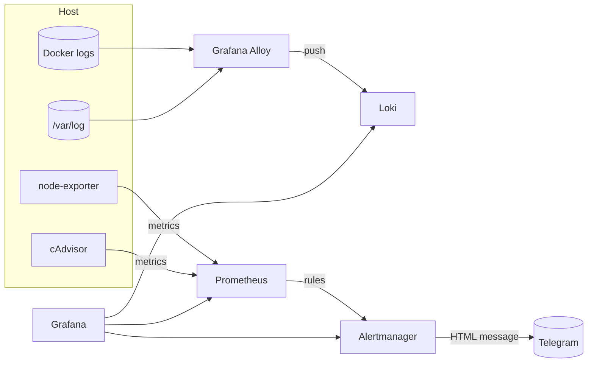

# observability-stack

[](https://github.com/HOFFMAN-ALTERNATIVE/observability-stack/actions/workflows/ci.yml)


**Production-ready metrics, logs and alerting for a single server or small fleet — one `docker compose up`.**

Prometheus · Alertmanager (Telegram) · Grafana (provisioned) · Loki · Grafana Alloy · node-exporter · cAdvisor

## Why

Setting up monitoring by hand means a day of glue: datasources, dashboards, alert rules nobody tested, a log shipper that silently
drops data. This stack is **provisioned as code and verified end-to-end in CI**: every push boots the full stack, checks
that every scrape target is up, rules evaluate, Grafana datasources are healthy, container logs arrive in Loki and an alert
travels all the way to Alertmanager.

## Features

- **Metrics** — host (node-exporter) and per-container (cAdvisor) metrics, self-monitoring of every component
- **Logs** — Docker container logs + host logs (syslog, auth, nginx) shipped by **Grafana Alloy**, labelled by container / compose service / level
- **Dashboards** — "Host & Containers" dashboard provisioned from JSON: CPU, memory, disk, network, I/O, container CPU/RAM, live error logs
- **Alerting** — tested rules (CPU, memory, disk-fill prediction with `predict_linear`, OOM kills, target down, restart loops, container memory limits, Watchdog heartbeat), routed to **Telegram** with an HTML template; critical inhibits warning
- **Secure defaults** — ports bound to `127.0.0.1`, Grafana sign-up/anonymous disabled, required admin password, Telegram token never stored in config files, log rotation on every container, retention limits
- **Tested** — `promtool test rules` unit tests for alert rules, `amtool check-config`, `alloy fmt`, `docker compose config`, and a full-stack smoke test in CI

> **Note:** Promtail reached end-of-life; Grafana Alloy is its official successor and is used here.

## Quick start

```bash
git clone https://github.com/HOFFMAN-ALTERNATIVE/observability-stack.git && cd observability-stack
cp .env.example .env          # set GRAFANA_ADMIN_PASSWORD, TELEGRAM_BOT_TOKEN, TELEGRAM_CHAT_ID
docker compose up -d
./scripts/smoke-test.sh       # verifies the whole pipeline (needs curl + jq)
```

| UI | URL |
|---|---|
| Grafana | http://127.0.0.1:3000 → *Observability / Host & Containers* |
| Prometheus | http://127.0.0.1:9090 |
| Alertmanager | http://127.0.0.1:9093 |

For remote access, keep `BIND_ADDR=127.0.0.1` and put a TLS reverse proxy (Caddy/nginx) or an SSH tunnel in front:
`ssh -L 3000:127.0.0.1:3000 user@server`.

## Architecture



## Telegram alerts

1. Create a bot with [@BotFather](https://t.me/BotFather), copy the token.
2. Send any message to the bot (or add it to a group), then get the chat id: `curl https://api.telegram.org/bot<TOKEN>/getUpdates`.
3. Set `TELEGRAM_BOT_TOKEN` and `TELEGRAM_CHAT_ID` in `.env`, `docker compose up -d alertmanager`.

The token is written at container start to a private file read via `bot_token_file`; it never appears in the rendered config or the Alertmanager UI.
Message format lives in `alertmanager/templates/telegram.tmpl`:

```
🔥 FIRING · HostDiskWillFillIn24h (1)
CRITICAL Disk / on host will fill within 24h
Only 1.2GiB predicted free in 24h.
```

## Adding your services

```yaml
# prometheus/prometheus.yml
  - job_name: api
    static_configs:
      - targets: ["api:8000"]
```

Attach the service to the `observability_obs` network (or use `host.docker.internal`) and reload: `curl -X POST localhost:9090/-/reload`.
Logs of any container on the host are collected automatically.

## Layout

```
compose.yml
prometheus/   prometheus.yml, rules/ (host.yml, targets.yml)
alertmanager/ alertmanager.yml, templates/telegram.tmpl, entrypoint.sh
grafana/      provisioning/ (datasources, dashboards), dashboards/*.json
loki/         loki.yml (TSDB schema v13, 7-day retention, compactor)
alloy/        config.alloy
tests/        promtool rule unit tests
scripts/      smoke-test.sh, screenshot.mjs
```

## Development

```bash
promtool check config prometheus/prometheus.yml
promtool test rules tests/host_test.yml
amtool check-config alertmanager/alertmanager.yml
```

## License

MIT — see [LICENSE](LICENSE).
